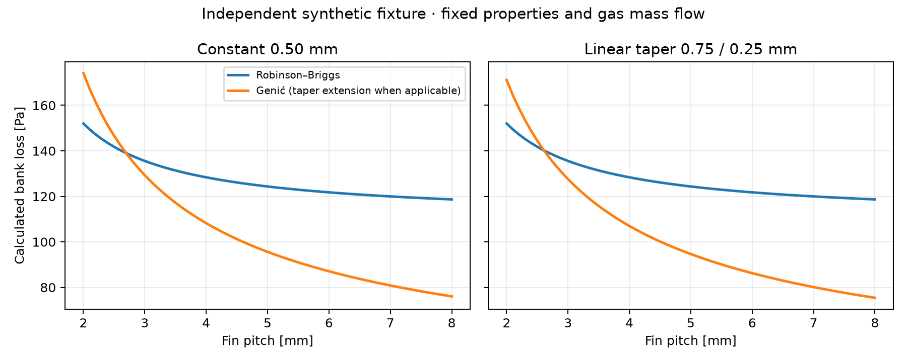

# v0.9.11 extended-surface airside hydraulics

Development starts at merged v0.9.10 `3944addb412b040bd2efc16fe78780713a40601d`.
This release extends Genić hydraulics and makes it STAGGERED hydraulic AUTO
within its supported scalar domain. Robinson–Briggs remains an explicit
reference; Frass Eq.191 remains INLINE AUTO. See the [selection rules](../finned_hydraulic_auto.md).
Thermal equations, coefficients and default selection are unchanged.

## Candidate decisions and provenance

| Candidate | Public release decision | Remaining limitation |
| --- | --- | --- |
| Genić 2006 | Retain constant-fin providers; add explicit tapered geometry options | Raw calibration data unavailable; taper is an unvalidated engineering extension |
| Nir 1991 | Defer public hydraulic provider | Plain-fin equations recovered from legitimate secondary sources; original normalization, row interpretation, property reduction, pressure scope and joint applicability remain unresolved |
| VDI Heat Atlas | Exclude restricted formulas and implementations from public core | Finned-tube thermal reconstruction alone cannot establish a hydraulic model; edition-specific hydraulic provenance and pressure scope need separate review |
| ESCOA STAGGERED solid fin | Archive hydraulic candidate | No active public provider; existing ESCOA thermal and Frass INLINE models remain available |

Genić's primary publication closes the implemented coefficient, equivalent
diameter, minimum-passage velocity, physical-row normalization and explicit
limits. See the [method and source record](../genic2006_finned_hydraulics.md).
The new taper geometry is an independent geometric derivation in the unchanged
empirical fit. Existing constant-fin selectors still reject taper. Strict
source mode rejects the extension; no automatic fallback is added.

The [Nir publication lead](https://doi.org/10.1080/01457639108939746)
and the legitimate NTNU deposit of [Eikill's 2013 thesis](https://hdl.handle.net/11250/2353751)
are distinct evidence. The thesis reproduces plain and segmented formulations,
hydraulic diameter and a geometry-factor transition at Rd=1.3. Its internal
normalization and applicability ambiguities prevent public promotion; no hybrid
is assembled from conflicting secondary variants. Source recovery has improved
without closing all release gates. Publication access does not authorize
redistributing text, tables, figures or protected code. No external implementation
or publication copy is included.

## Independent synthetic comparison

The reproducible [example](../../examples/extended_surface_hydraulics.py) uses
ID/root OD/fin OD 27/31/61 mm, effective/total length 1.76/1.8 m,
eight rows of nine tubes, transverse pitch 74 mm and equilateral stagger.
Gas mass flow is 3.7 kg/s; fixed rho=1.05 kg/m³ and mu=2.05e-5 Pa s.
Constant fins are 0.50 mm thick; taper is 0.75/0.25 mm root/tip. The profiles
have equal projected blockage. Only fin pitch varies within each profile.
These inputs were independently constructed for public regression use.

| Fin profile | Model | Bank loss at 2 mm [Pa] | At 8 mm [Pa] | Change |
| --- | --- | ---: | ---: | ---: |
| Constant | Robinson–Briggs | 152.015948 | 118.664098 | -21.940% |
| Constant | Genić | 174.170606 | 76.037268 | -56.343% |
| Linear taper | Robinson–Briggs | 152.015948 | 118.664098 | -21.940% |
| Linear taper | Genić geometry extension | 171.138453 | 75.411775 | -55.935% |



The 61-point grid spans 2–8 mm in 0.1 mm steps. It holds physical row count,
geometry other than fin pitch, mass flow and properties fixed. Warnings are
retained in the example output. Both Genić profiles pass the audited scalar
staggered equation limits on this grid; tapered geometry remains unvalidated
at every point. Robinson–Briggs source-range warnings occur across this broad
sweep. This table compares calculated predictions, without experimental data
or a claim of validated accuracy.

Robinson–Briggs responds through blockage and Reynolds number. Genić also
responds through extended-surface geometric groups. Equal mean blockage makes
the Robinson–Briggs curves identical for these profiles. Genić distinguishes
their actual surface and void geometry. No coefficient was fitted to obtain
this difference. Fixed properties make acceleration zero; the table excludes
local duct losses. Absolute pressures and sensitivity must both be reviewed
alongside applicability and source provenance. The authorized AUTO change uses
Genić; it does not establish experimental validation of the tapered extension.

Reproduce the public comparison from the repository root:

```powershell
py -3.11 -m examples.extended_surface_hydraulics
py -3.11 -m pytest core/tests/genic2006_pressure_drop_test.py core/tests/genic2006_tapered_test.py -q
```

## Regression and release checks

Independent quadrature checks projected passages, inclined faces, primary/tip
surface, metal volume, porosity, equivalent diameter and pressure normalization
for both layouts and three pitches. Integration tests check constant-fin
identity, explicit selection, strict rejection, separate acceleration, typed
authorization and unchanged thermal results in Rating and Simulation.

The [public release matrix](v0.9.11_public_test_selection.json) passes **1,543
distinct tests**, with no failures or skips (Python 3.11.9, CoolProp 8.0.0).
The matrix includes 15 taper cases, 19 AUTO/policy/independent-channel cases
and 10 additional INLINE sensitivity/qualified-scope cases.
Historical thermal fixtures explicitly retain Robinson–Briggs so their original
numerical assertions remain meaningful. Explicit Genić and Robinson–Briggs
regressions preserve prior arithmetic; new AUTO tests cover the intended change.
The matrix extends the existing v0.9.10 dry-airside and geometry selections
with the new taper cases, external-provider policies, local pressure losses,
roughness, row populations, parity and circuit checks. Run it with:

```python
import json
import pytest
with open('docs/validation/v0.9.11_public_test_selection.json') as stream:
    raise SystemExit(pytest.main(['-q', *json.load(stream)]))
```

A separate 300-case synthetic comparison against merged v0.9.10 preserves
every existing constant-fin result field and diagnostic key exactly; only
new source-verification diagnostics are added. The final INLINE review also
corrects its source-applicability/engineering flags and exposes qualified pressure
scope, without changing pressure values. A further 300 comparisons preserve
tapered-fin outputs from the preceding implementation exactly. The public
example reports 366 predictions including AUTO; its explicit predictions
preserve the comparison values above. This is a selected regression matrix,
not a full-suite pass claim. No unrelated physical models were modified.

Source, runtime and distribution metadata agree on 0.9.11. Wheel and source
distributions built from a public-only snapshot contain the Genić extension
and tests, with no private-data/provider or restricted-formulation findings.
Thermal equations are unchanged; dispatch carries known fluid identity into
source warnings. The machine-readable
[receipt](v0.9.11_test_summary.json) records the selected regression result.
Numerical/API regression checks do not establish experimental validation.
